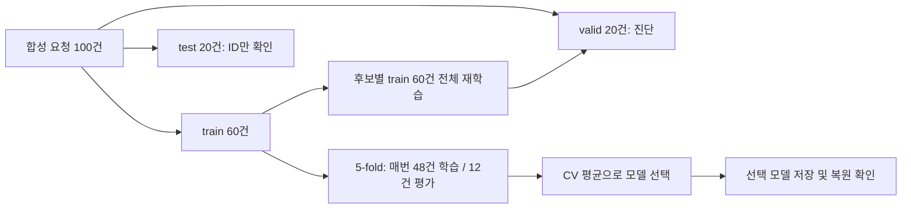

# 요청 실행 전 실패 여부와 소요시간 예측

특심화 07을 **데이터 이해 → 문제 정의 → 모델 비교 → 결과 해석 → 재현** 순서로 수행한 학습 프로젝트입니다. Python 문법을 채우는 데서 끝내지 않고, 어떤 정보를 보고 무엇을 예측하며 결과를 어디까지 믿을 수 있는지 기록합니다.

**실행 결과:** train 내부 교차검증으로 분류는 XGBoost, 회귀는 KNN(이웃 15개)을 선택했습니다. 그러나 검증 자료에서 XGBoost는 실패 6건 중 5건을 놓쳤고, 회귀 개선도 작았습니다. 따라서 현재 결과는 운영 배포 근거가 아니라 실험 과정과 한계를 확인한 학습 기록입니다.

## 1. 어떤 상황에서 필요한가?

요청을 처리하는 시스템을 가정해 봅니다. 사용자가 작업을 제출하면 실행 전에 입력 길이, 허용 도구 수, 작업 종류, 우선순위를 알 수 있습니다. 이 정보로 다음 두 질문에 답해 봅니다.

| 문제 | 예측하려는 정답 | 활용을 생각해 볼 수 있는 상황 |
|---|---|---|
| 분류 | `failed`: 성공 0 / 실패 1 | 실패 위험이 높은 요청을 미리 점검 |
| 회귀 | `elapsed_ms`: 실제 실행시간, 밀리초 | 대기시간 안내와 실행 일정 계획 보조 |

위 활용 상황은 **이 프로젝트를 이해하기 위한 가정**입니다. 자료에는 특정 서비스, 실제 실패 기준, 오류 비용이 정의되어 있지 않습니다. 운영상 효과를 입증했다고 주장하지 않습니다.

## 2. 데이터 한 줄부터 읽기

자료는 실제 기업 로그가 아닌 **교육용 합성 요청 100건(seed=23)**입니다. 상세 출처와 열 의미는 [데이터 사전](data/데이터_사전.md), [메타데이터](data/dataset_metadata.json)에 있습니다.

검증 자료에 속한 `R001`을 예로 들어 봅니다.

| 시점·역할 | 열 | 값 | 해석 |
|---|---|---|---|
| 실행 전 입력 X | `input_chars` | 1549 | 입력 글자 수 |
| 실행 전 입력 X | `allowed_tools` | 4 | 허용 도구 수 |
| 실행 전 입력 X | `task_type` | summary | 요약 작업 |
| 실행 전 입력 X | `priority` | normal | 보통 우선순위 |
| 분류 정답 y | `failed` | 1 | 실제 실패 |
| 회귀 정답 y | `elapsed_ms` | 1994 | 실제 1.994초 소요 |
| 실행 후 기록 | `status`, `retry_count` | error, 2 | 결과 상태와 재시도 횟수 |

모델에는 **위의 입력 4개만** 제공합니다. 실행 전에 예측할 때 `status`와 `retry_count`는 아직 알 수 없으므로 제외합니다. 분류에 실제 실행시간을, 회귀에 실제 실패 여부를 넣는 것도 같은 이유로 금지합니다. `request_id`는 행을 맞추는 이름표이며 예측 입력이 아닙니다.

첫 명령 `python inspect_data.py`는 train/valid의 결측 수, 클래스 수, 학습 실행시간 분포를 출력하고 [data_overview.json](outputs/data_overview.json)을 생성합니다. 보관 test의 입력·정답은 분석하지 않습니다.

## 3. 어떻게 공정하게 비교하는가?

제공된 고정 분할과 행 순서를 그대로 사용합니다. 새로 유리한 분할을 뽑지 않습니다.



train에는 성공 42건·실패 18건, valid에는 성공 14건·실패 6건이 있습니다. 분류는 비율을 유지하는 `StratifiedKFold`, 회귀는 `KFold`를 사용하고 둘 다 5분할, shuffle, seed=42입니다. 같은 문제의 모든 후보는 동일한 fold를 사용합니다.

전처리와 모델을 하나의 `Pipeline`으로 묶습니다. 각 fold의 학습 48건으로 수치 결측의 중앙값, 범주 결측의 최빈값, 범주 목록과 표준화 통계를 배웁니다. 평가 12건이나 valid에서 미리 통계를 배우지 않습니다. 이 방식은 [scikit-learn의 데이터 누수 방지 지침](https://scikit-learn.org/stable/common_pitfalls.html#data-leakage)을 따릅니다.

- 숫자 2열: 중앙값으로 빈칸 채우기 → 선형·KNN 모델에서는 표준화.
- 범주 2열: 최빈값으로 빈칸 채우기 → 원핫 인코딩. 전체 train 학습 후 총 입력은 8열입니다.
- 트리 계열은 숫자를 표준화하지 않습니다. Dummy의 표준화는 수업의 비교 계약을 유지하며 예측에는 영향을 주지 않습니다.
- 새로운 범주는 해당 원핫 블록을 0으로 처리합니다. 정확히 입력 4열인지 검사하는 `check_features`는 예측 전에 별도로 호출합니다. 저장 Pipeline 자체가 추가 열을 거절하는 것은 아닙니다.

## 4. 왜 이 모델들을 비교하는가?

처음부터 XGBoost가 가장 좋다고 가정하지 않습니다. 복잡한 모델을 쓰는 것이 단순한 기준보다 실제로 유용한지부터 확인합니다.

| 계열 | 분류 / 회귀 후보 | 비교하려는 아이디어 | 주요 고정 설정 |
|---|---|---|---|
| Dummy | 최빈값 / 평균 | 아무 관계도 배우지 않는 기준보다 나은가? | 성공만 / train 평균 시간 |
| 선형 | Logistic / Linear | 단순한 선형 관계로 설명할 수 있는가? | Logistic C=1, 반복 최대 1000 |
| KNN | KNN3 / KNN15 | 비슷한 요청의 결과를 참고하면 어떤가? | 이웃 수 3 / 15 |
| Tree | 결정트리 / 회귀트리 | 입력 조건과 임계값으로 나눠 보면 어떤가? | 깊이 3, 잎 최소 3건 |
| Forest | 랜덤포레스트 | 여러 트리를 묶어 단일 트리와 비교 | 100개, 깊이 4, 잎 최소 2건 |
| XGB | XGBoost | 앞 모델의 오차를 줄이도록 트리를 순차 추가 | 80회, 깊이 2, 학습률 0.05 |

설정은 수업에서 사전에 정한 비교 조건입니다. K=15 등이 이 자료의 최적값이라는 뜻은 아닙니다. 전체 설정은 [model_config.py](model_config.py)에 있습니다.

## 5. 무엇을 기준으로 선택했는가?

**분류는 train 내부 5개 F1의 평균이 가장 큰 후보**, **회귀는 5개 RMSE의 평균이 가장 작은 후보**를 선택합니다. 정확히 같은 평균이면 위 표의 선언 순서가 우선합니다. valid 순위를 보고 선택을 바꾸지 않습니다.

분류에서 성공만 예측해도 valid 정확도는 70%입니다. 하지만 실패를 하나도 찾아내지 못하므로 실패 클래스의 정밀도와 재현율을 함께 반영하는 F1을 사용합니다. F1은 이 실습의 비교 기준이며 실제 서비스 비용을 최적화했다고 볼 수 없습니다. 회귀 RMSE는 오차를 제곱해 평균한 뒤 제곱근을 취하므로 큰 오차의 영향을 받으며, 단위는 정답과 같은 ms입니다. [평가 지표 공식 문서](https://scikit-learn.org/stable/modules/model_evaluation.html)

| 문제 | CV 선택 | CV 평균 ± fold 표준편차 | valid 진단 | Dummy valid |
|---|---|---|---|---|
| 실패 분류 | XGB | F1 **0.5467 ± 0.1046** | F1 **0.2000** | F1 0.0000 |
| 실행시간 회귀 | KNN15 | RMSE **598.85 ± 91.21 ms** | RMSE **641.79 ms**, MAE 530.06 ms | RMSE 658.75 ms |

이 표의 표준편차는 fold 간 변동이며 신뢰구간이 아닙니다. CV 선택 점수와 valid 성능은 별개입니다. valid에서 분류 F1이 가장 높은 후보는 KNN3(0.5455), 회귀 RMSE가 가장 낮은 후보는 Linear(640.00ms)였습니다. 이 사실로 사전 선택 규칙을 뒤집지는 않았습니다.

## 6. 결과를 한 요청으로 해석하기

선택된 XGBoost는 valid의 실제 실패 6건 중 1건만 찾았습니다(TP=1, FN=5). 성공을 실패로 잘못 표시한 경우도 3건입니다(FP=3). R001의 실패 확률 출력은 약 0.1947이고 예측은 성공(0)이었지만 실제로는 실패(1)했습니다. 확률 출력이 실제 운영 실패율로 보정됐다고 가정하지 않습니다.

선택된 KNN15는 R001을 1252.73ms로 예측했지만 실제는 1994ms였으므로 741.27ms 짧게 예측했습니다. valid 전체 RMSE는 train 평균만 내는 Dummy보다 약 16.96ms(2.57%) 낮지만, 이것만으로 유의미한 운영 개선을 입증할 수 없습니다. 전체 후보의 valid R²도 음수입니다.

더 자세한 후보 표, 실패 요청 ID, 큰 회귀 오차, 중요도 해석은 [실험 보고서](reports/ensemble_report.md)에 있습니다. 중요도는 **Forest를 대상으로 한 별도 진단**이며 선택된 XGB의 설명이 아닙니다. MDI는 train에서, 순열 중요도는 valid에서 원본 열을 10번씩 섞어 계산했습니다. 중요도는 인과관계나 자동 특성 삭제의 근거가 아닙니다. [순열 중요도 해석 지침](https://scikit-learn.org/stable/modules/permutation_importance.html)

별도 TreeGrid 탐색은 깊이 [2,4] × 잎 최소 [1,3]의 4조건을 비교했습니다. 최적 조건은 깊이 4·잎 최소 1, CV F1은 0.7187입니다. 탐색에 사용한 점수이므로 독립 최종 성능이 아니며 기본 비교표나 저장 모델을 교체하지 않았습니다.

## 7. 직접 한 단계씩 실행하기

Windows PowerShell에서 **이 README가 있는 프로젝트 폴더**를 엽니다. Python 3.13이 설치되어 있다고 가정합니다. 이번 기록은 Windows / Python 3.13.16에서 생성했습니다.

```powershell
# 최초 1회: 독립 환경과 지정 버전 설치
python -m venv .venv
.\.venv\Scripts\python.exe -m pip install -r requirements-lock.txt

# 1단계: 데이터의 입력·정답·결측·분할부터 읽기
.\.venv\Scripts\python.exe -X utf8 inspect_data.py

# 2~5단계: 전처리 → 6후보 비교 → CV 선택 → 중요도·별도 탐색
.\.venv\Scripts\python.exe -X utf8 main.py --level 3

# 6단계: 테스트, 결과표의 지표·ID·분할 검사, 새 프로세스 복원
.\.venv\Scripts\python.exe -X utf8 -m unittest -v test_project.py
.\.venv\Scripts\python.exe -X utf8 verify_outputs.py
.\.venv\Scripts\python.exe -X utf8 restore_check.py --trust-local-models

# 7단계: 새 요청 2건으로 실제 사용 흐름 확인
.\.venv\Scripts\python.exe -X utf8 predict_new.py --trust-local-models
```

`--trust-local-models`는 방금 본인이 만든 모델에만 사용합니다. 모델 파일은 GitHub에 올리지 않고 `main.py`로 재생성합니다. macOS/Linux에서는 `.venv/bin/python`으로 경로를 바꿉니다. 이 기록에서 다른 운영체제 실행까지 검증한 것은 아닙니다.

한 번에 모든 코드를 읽기 어렵다면 `main.py --level 1 --output outputs_level1`로 기본 분류 4후보만 실행할 수 있습니다. `--level 2 --output outputs_level2`는 분류 6후보·회귀를 실행하고, 3단계는 TreeGrid까지 추가합니다. 각 단계 출력 폴더를 구분해야 이전 결과가 섞이지 않습니다. `verify_outputs.py`는 level 3 결과를 검사합니다.

## 8. 파일을 읽는 순서와 결과 위치

| 순서 | 파일 | 읽으면서 답할 질문 |
|---|---|---|
| 1 | [inspect_data.py](inspect_data.py) | 한 행은 무엇이며, 실행 전에 알 수 있는 값은 무엇인가? |
| 2 | [preprocessing.py](preprocessing.py) | 결측과 글자 범주를 모델 입력으로 어떻게 바꾸는가? |
| 3 | [model_config.py](model_config.py) | 모델 설정과 같은 비교 조건을 어디서 정하는가? |
| 4 | [evaluate.py](evaluate.py) | 학습용 CV와 valid 진단을 어떻게 분리하는가? |
| 5 | [main.py](main.py) | 각 단계를 어떻게 연결하고 결과를 저장하는가? |
| 6 | [reports/ensemble_report.md](reports/ensemble_report.md) | 결과가 실제로 어떤 오류와 한계를 뜻하는가? |
| 7 | [학습기록.md](학습기록.md) | 내가 이해한 선택 이유를 설명할 수 있는가? |

`outputs/classification_comparison.csv`, `regression_comparison.csv`에는 모든 후보의 CV·train·valid 점수가 있습니다. `cv_scores.csv`는 60개 fold 점수, `validation_predictions.csv`는 240개 예측, `fold_manifest.csv`는 ID별 fold 소속입니다. `run_summary.json`에는 선택, 데이터 해시, 패키지 버전이 있습니다. 실제 검증 기록은 [reports/test_record.md](reports/test_record.md)를 보세요.

`expected_outputs/`와 `expected_output.txt`는 수업의 참고 결과입니다. 이번 실행은 이 파일들을 읽어 결과를 만들지 않습니다. 운영체제나 라이브러리 버전 차이로 작은 차이가 날 수 있어 실제 실행 결과를 그대로 기록했습니다. 원래 과제 설명은 [original_assignment.md](reports/original_assignment.md)에 보존했습니다.

## 한계와 다음 실험

합성 데이터 100건, 학습 60건은 매우 작고 실제 요청을 대표하지 않습니다. 선택 XGB와 Tree의 CV F1 차이는 약 0.0042로 fold 변동보다 작아 우열을 강하게 주장하기 어렵습니다. CV는 모델을 고르는 데 사용했고 valid도 이전 수업부터 반복 진단했으므로 둘 다 독립적인 최종 성능으로 제시하지 않습니다. 보관 test는 이번 프로젝트에서 평가하지 않았습니다.

다음에는 실제 실패의 정의와 FP/FN 비용부터 정하고, 더 많은 대표 데이터를 확보해야 합니다. 학습 자료 내부 반복 CV로 선택 안정성을 확인하고, 실패를 덜 놓쳐야 한다면 train 내부에서만 임계값과 비용을 검토할 수 있습니다. 이번 결과를 보고 valid에 맞춰 설정을 고치는 실험은 하지 않았습니다.

## 출처와 기여

원본은 제공된 `20261027/04_특심화/07_특심화/day7_ensemble` 실습입니다. 원본 코드·합성 데이터의 저작권과 BSD 2-Clause [LICENSE](LICENSE)(Copyright 2026 kangminjun)를 유지합니다. TODO 구현, 상세 주석, 데이터 확인·새 요청 예측·출력 감사, 한국어 설명과 보고서는 AI 도움으로 보완했습니다. 사용자가 직접 모든 코드를 작성했거나 내용을 이해했다고 대신 주장하지 않습니다.

GitHub에 올리는 과정을 다시 해 보고 싶다면 [Git 기록 안내](Git_기록_안내.md)를 참고하세요.
